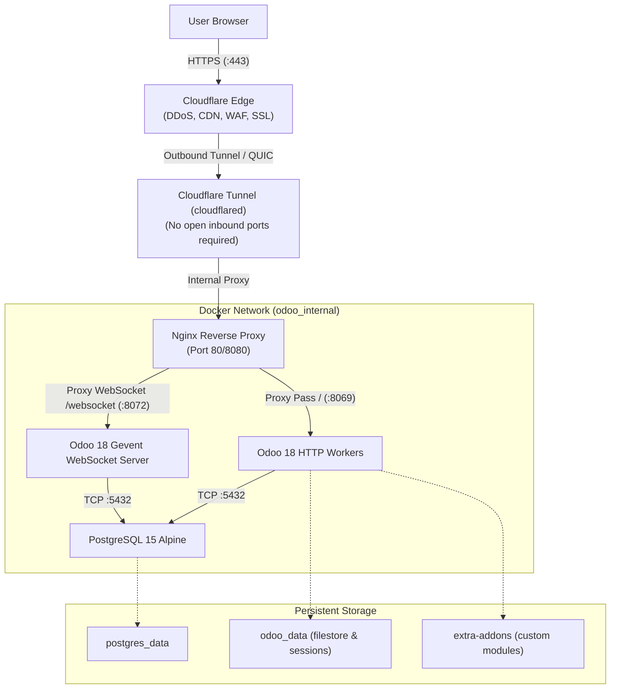

# System Architecture

## Overview
This project deploys **Odoo 18.0 Community Edition** with **PostgreSQL 15** and **Nginx Reverse Proxy**, optimized for:
1. **Local Development / Sandbox**: Docker Desktop on Windows 11 with WSL2.
2. **Production Deployment**: Oracle Cloud Infrastructure (OCI) Ampere A1 Flex VM (Ubuntu 24.04 ARM64, 2 OCPUs, 12 GB RAM) behind Cloudflare Tunnel.

## Security Model
* **Zero Public Database Exposure**: PostgreSQL port 5432 is strictly bound to `odoo_internal` bridge network with no host port mapping.
* **Zero Public Odoo Ports**: Odoo ports 8069 and 8072 are only accessible via Nginx.
* **Database Manager Lockdown**: Nginx blocks `/web/database/manager` from external untrusted IPs.
* **Secret Isolation**: All credentials live exclusively in `.env` (gitignored).

